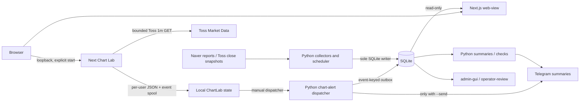

# Stock Monitor


Python 수집기와 SQLite, Next.js 공개 화면을 함께 쓰는 개인용 주식 리서치 모니터입니다. Python은 수집·저장·기존 운영 자동화의 유일한 SQLite 쓰기 주체이고, Next.js는 읽기 전용 공개 화면과 loopback 전용 Chart Lab을 제공합니다.

이 프로젝트는 자동매매나 투자 판단 시스템이 아닙니다. 공개 화면과 알림은 리포트, 시장 참고값, 후보 근거를 정리해 보여주는 용도이며, 공개 숫자 점수, 투자 등급, 매수/매도 지시, 진입/청산가, 주문 라우팅, 브로커 실행 연동은 제공하지 않습니다.

## Highlights

- Naver 국내종목 리서치 리포트를 장중 수집하고 SQLite에 저장합니다.
- 전영업일 요약, 장중 신규 리포트, 운영 상태를 Telegram으로 확인합니다.
- `web-view` 시장/ETF/수급 참고값은 저장된 Toss 20:00 종가 스냅샷을 사용합니다. 기존 KRX 행은 과거 분석/복기 전용입니다.
- `web-view`는 친구 공유 후보가 되는 GET-only/read-only 정보 화면입니다.
- Next.js의 별도 Chart Lab은 보고서 집중 후보 최대 3개를 Toss 1분봉으로 관찰할 수 있습니다. 시작은 명시적인 로컬 조작이며, Next는 local event spool만 씁니다.
- Chart Lab Telegram 경로는 Python이 outbox를 소유합니다. `chart-alerts-dispatch`는 미리보기가 기본이고, `--send`를 직접 지정해야 실제 Telegram을 한 번 시도합니다. 자동 Task Scheduler 등록은 없습니다.
- `admin-gui`는 로컬 운영자 전용 콘솔로, 공유 화면과 분리됩니다.

현재 코드는 실행 가능한 MVP 상태입니다. 다만 운영 closeout 여부와 열린 blocker는 README가 아니라 [operating-guide.md](docs/codex/operating-guide.md)를 기준으로 봅니다.

## What It Shows

| Area | User-facing output |
| --- | --- |
| Main priority | Stored-date Main Top2, plus user-triggered Toss quote/flow and adjusted daily chart/indicator references |
| Reports | 일간 리포트 개요, 종목별 리포트 상세, 목표가 변화 |
| Candidate evidence | `오늘의 관찰 후보`, `우선 확인`, `왜 눈에 띄는지`, 부족한 정보 |
| Chart Lab | Loopback-only chart review and explicit report-focus minute-bar observation |
| Market reference | 저장된 Toss 20:00 시장/ETF/거래대금 참고값 |
| Flow reference | 저장된 Toss 시장 및 후보 종목 수급 참고값 |
| Rotation context | 업종/테마/ETF 순환매 참고와 저장 근거 |
| Operations | DB 검증, 스케줄러 상태, Telegram worker, admin audit |

## What It Does Not Do

- 공개 숫자 점수나 투자 등급을 만들지 않습니다.
- 일반적인 매수/매도 추천이나 특정 진입가·청산가·익절가를 제시하지 않습니다. Main Top2에 한해 사용자가 정의한 과거봉 가격 기준과 보조지표 확인 상태를 별도 참고값으로 표시합니다 ([세부 계약](docs/codex/data-governance.md#main-top2-technical-indicator-projection)).
- 주문, 브로커 실행, 계좌/잔고/체결 경로를 연결하지 않습니다.
- KRX Data Marketplace broad ingest를 자동화하지 않습니다.
- `admin-gui`를 외부 공유 화면으로 쓰지 않습니다.
- 차트 관찰을 매수·매도 추천, 점수, 주문, Main 후보 순서 변경으로 사용하지 않습니다.
- Chart Lab은 기본으로 Telegram을 보내거나 scheduler 작업을 등록하지 않습니다.
- 임의 lab/source probe를 DB write, Telegram send, scheduler job, public surface에 연결하지 않습니다.

## Architecture



Source ownership stays explicit:

- Naver owns research reports.
- Toss OpenAPI owns current and newly stored `web-view` market references; existing KRX rows are retained for historical analysis only.
- 업종/테마 are a project taxonomy/display layer, not a KRX official taxonomy.
- User-facing surfaces show stored-data references unless a manual reference check is clearly labeled.

## Surfaces

| Surface | Audience | Boundary |
| --- | --- | --- |
| `web-view` | Trusted read-only viewers | GET-only data routes, stored-data first, no scheduler or settings exposure |
| Chart Lab | Local operator | Loopback-only chart review and report-focus minute-bar observations; no Next SQLite writes |
| `admin-gui` | Local operator | Status, safe controls, settings, audit, scheduler recovery |
| Telegram | Operator channel | Summary, alert, command worker, safe read-only status replies |
| `operator-review` | Local operator | Separate loopback-only GET panel for selected-date candidate evidence; read-only DB access |

`web-view`의 `/v2`는 정보 구조 검토용 preview route입니다. 기본 공유 화면을 대체하려면 별도 문서, 테스트, 브라우저 검증을 거쳐야 합니다.

## Quick Start

```powershell
python -m venv .venv
.\.venv\Scripts\python.exe -m pip install -e ".[dev]"
.\.venv\Scripts\python.exe -m playwright install chromium
.\.venv\Scripts\python.exe -m pytest
```

The project venv must be used for Python-backed Next regression tests as well. In PowerShell, prepend `..venvScripts` to the current process `PATH` before running `npm test`; otherwise a system Python without the project's `tzdata` dependency may be selected.

실제 비밀값은 `.env`에만 둡니다. 추적되는 예시는 [.env.example](.env.example)을 참고하세요.

## Common Commands

Daily minimal checks:

```powershell
python -m stock_monitor db-verify --json
python -m stock_monitor candidate-evidence-readiness --recent-report-dates 5 --stock-limit 20 --json
python -m stock_monitor web-view-value-qa --recent-business-days 4 --stock-limit 20 --json
python -m stock_monitor web-view-browser-smoke --date latest --json
python -m stock_monitor market-day-observation --date YYYY-MM-DD --json
```

Problem checks:

```powershell
python -m stock_monitor market-briefing-readiness --recent-report-dates 5 --json
python -m stock_monitor external-web-view-smoke --url https://YOUR-WEB-VIEW-URL --date YYYY-MM-DD --json
python -m stock_monitor db-restore-smoke PATH
```

Historical/deprecated closeout and audit commands remain callable for compatibility, but they are not active README workflow commands and are hidden from top-level CLI help.

Collection and summary:

```powershell
python -m stock_monitor inspect-page --limit 5
python -m stock_monitor manual-poll --limit 20
python -m stock_monitor summarize-previous-business-day
python -m stock_monitor send-test-notification --dry-run
```

Chart alert event preview and explicit delivery:

```powershell
python -m stock_monitor chart-alerts-dispatch --json
# After separately reviewing the schema migration and local Telegram configuration:
python -m stock_monitor chart-alerts-dispatch --send --watch
```

The first command validates local event files and stored report evidence without writing SQLite or sending Telegram. The second writes the Python-owned schema-12 outbox and sends one attempt per event; ambiguous outcomes are never retried automatically. It is not registered with Task Scheduler.

Local UI:

```powershell
Push-Location .\web
npm run build
Pop-Location
.\scripts\start_next_web_view.ps1 -Port 3010
.\scripts\start_next_web_view.ps1 -Port 3010 -Status
python -m stock_monitor admin-gui --no-open
```

The Next script uses the project build and binds only to `127.0.0.1`; run it from a PowerShell window and press `Ctrl+C` in that window to stop it. The Python `web-view` command remains available as a fallback/reference path.

Historical KRX reference review (not an active market-data refresh workflow):

```powershell
python -m stock_monitor krx-openapi-availability-probe --date latest --endpoint daily --json
python -m stock_monitor krx-backfill-missing daily --lookback-days 90 --max-dates 5 --dry-run
```

기존 KRX 행의 조회/복구 절차는 [market-data-runbook.md](docs/codex/market-data-runbook.md)를 따릅니다. Provider 호출, Telegram 발송, 스케줄러 변경, DB write가 있는 명령은 관련 문서를 먼저 확인하고 의도한 confirmation flag로만 실행합니다.

## Project Layout

| Path | Role |
| --- | --- |
| `src/stock_monitor` | Python package source |
| `tests` | pytest suite |
| `scripts` | Windows Task Scheduler and operation wrappers |
| `scripts/experimental` | lab-only experiments |
| `docs/codex` | canonical runbooks, contracts, current state, roadmap |
| `example` | visual reference assets |

## Documentation

The current document map is [docs/codex/documentation-index.md](docs/codex/documentation-index.md).

Key references:

- [stock_research_monitor_mvp.md](stock_research_monitor_mvp.md): product requirements and future intent; not a current implementation or operating-status source
- [surface-guide.md](docs/codex/surface-guide.md): `admin-gui` and GET-only `web-view` contract
- [operating-guide.md](docs/codex/operating-guide.md): current state, open blockers, and execution criteria
- [data-governance.md](docs/codex/data-governance.md): value rules and current source ownership
- [market-data-runbook.md](docs/codex/market-data-runbook.md): Toss 20:00 baseline and retained KRX historical-reference procedures
- [mini-pc-runbook.md](docs/codex/mini-pc-runbook.md): current scheduler names and timings
