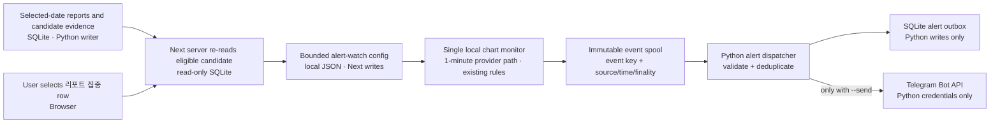
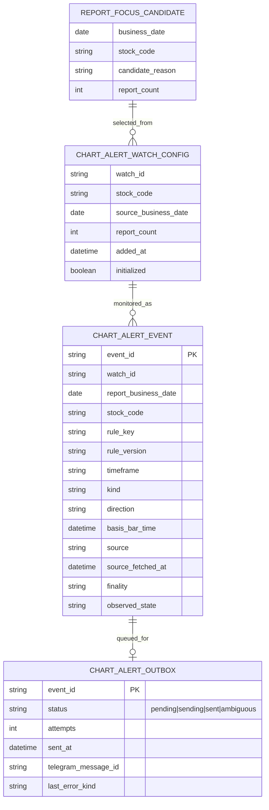

# Report-Focused Chart Watch and Telegram Alerts

> **Status: development implementation present; operational activation pending.** The local Next watch/event-spool path, Python event validator/outbox command, migration 12, and documentation contract are implemented. No live Toss request, Telegram send, operating DB migration, Task Scheduler change, or Operations-PC test was performed by this development work.

## Assessment

The idea is feasible, but the existing chart monitor is not a real-time alert service. It polls daily bars, records local pattern events, and has no Telegram path. A near-live version needs an intraday source, event deduplication, restart recovery, and a Python-owned delivery path.

The proposed first scope is limited to stocks the user explicitly adds from selected-date candidate rows marked `리포트 집중`. The watch must not change candidate membership/order, and alert text must not add scores, trade recommendations, target prices, or orders.

## Current State

| Area | Verified current behavior | Consequence for this proposal |
| --- | --- | --- |
| Candidate evidence | Next reads selected-date evidence from SQLite read-only. `리포트 집중` is a descriptive candidate reason. | The add action must revalidate the selected date, six-digit code, and reason on the server. A browser-provided `focus=true` is not proof of eligibility. |
| Chart watchlist | User groups are stored in browser `localStorage`; search can include Yahoo tickers. | It is not an alert source-of-truth and carries no report provenance. Keep existing chart groups; add a separate report-derived alert selection. |
| Chart monitor | Explicit start/pause; up to 20 symbols and 3 focus symbols; server state/events in local JSON. | It is a local experimental monitor, not a scheduler or Telegram sender. Its timer is process-local; after restart, it is re-armed only when the status route is read. Two Next processes share the same local state path and have no cross-process lock. |
| Monitor data | It calls `chartExplorerService.getChart(..., "1d")`, then detects pattern events. Regular/focus intervals are 5 minutes/30 seconds. | The 30-second interval does not mean 30-second market data. The REST candle row has no finality flag; internal finality stays `unknown` and the message says `봉 확정 상태 제공 안 됨`. |
| Provider | Korean-stock Chart Explorer reads adjusted daily Toss candles, up to four 200-bar pages; H4 uses Yahoo hourly bars. An internal service limits cache-miss upstream requests to 12 per minute. | Three focus symbols polled every 30 seconds can demand up to 24 upstream page calls per minute before regular symbols. The 30-second cache also matches the focus interval, so a poll can reuse prior bars; `lastPollAt` is the request start, not proof of a fresh provider fetch. A live monitor must request incremental bars after a bounded warm-up and trigger only on a new basis-bar time plus `source_fetched_at`. |
| Telegram | Python owns credentials and sends. Daily summaries have fragment/outbox state; the generic `delivery_log` allows only one successful row per business date/channel. | A separate event-keyed alert outbox is needed. The existing daily-summary outbox cannot represent many chart events per day. |
| Delivery retry | The shared Telegram sender retries transport errors. A send accepted by Telegram with a lost response can be ambiguous; the operating guide leaves its retry policy open. | Alert retries must not blindly duplicate a message. Store an `ambiguous` state for operator review. |

Toss documents REST candles with `interval=1m` and a distinct `MARKET_DATA_CHART` rate group. Its documented candle response contains timestamp, OHLCV, and currency fields but no `isFinal` or finality state. The Python/Next event therefore keeps internal `finality=unknown`; never infer a confirmed or unconfirmed bar from wall-clock time alone. The bounded local Chart Lab client allows one 200-bar `1m` page for an explicitly watched report-focus stock; public Main chart requests remain restricted to their existing `1d` path. Real-time trades also have a separate WebSocket API, which is not implemented. See the [official Market Data guide](https://developers.tossinvest.com/docs/market-data).

## Implemented Development Contract

1. `GET/POST /api/chart-lab/report-alerts` is same-origin loopback only. The server reads the selected date's candidate DTO and accepts only rows whose exact reason is `리포트 집중` and at least two saved reports. The watch cap is three; ordinary chart favorites and arbitrary Yahoo tickers cannot enter this alert watch.
2. The user explicitly adds candidates and separately starts or pauses monitoring. A per-user process lock prevents the `3010` preview and `8780` service from polling the same watch file concurrently. Persisted running state re-arms only when a later local status read acquires the lock.
3. The monitor uses Toss's fixed REST `interval=1m` request with one 200-bar page per symbol. It runs only during a regular session confirmed by Toss's cached KRX calendar. First poll establishes a baseline; later polls trigger only on new versioned experimental `m1-v1` pattern state transitions. A stale/missing latest bar and calendar/provider failure produce no alert.
4. Next writes watch state and deterministic event files only under the per-user ChartLab directory. Python validates the event hash and saved report evidence, then inserts an event-keyed schema-12 `chart_alert_outbox` row. Next never writes SQLite or receives Telegram credentials.
5. The dispatcher is read-only preview by default. `--send` is required to attempt a Telegram delivery; `--watch` also requires `--send` and is manually launched, not registered with Task Scheduler. Each event gets one transport attempt. Timeouts and interrupted `sending` rows become `ambiguous` and are not automatically retried.
6. Alert text contains the stock, observed pattern change, basis bar, compact KST source/fetch time, and report date/count. The message says `봉 확정 상태 제공 안 됨` because the provider has no finality field; the stored event retains `finality=unknown`. It adds no score, target price, buy/sell call, order, or Main candidate reorder.

The read-only preview command is implemented and prints the exact message text without sending. A delivery occurs only when the operator explicitly runs `chart-alerts-dispatch --send`; `--watch` also requires that flag. Task Scheduler registration and operating-PC activation remain separate later decisions.

## Data Flow and Boundaries



The spool is a handoff between two processes, not another database. Each event file is written atomically and has a deterministic hash over the watch, report provenance, rule, pattern, direction, basis start, and state. Python imports it transactionally; replaying the same file cannot create a second outbox row. No public route, external share, admin control, account/order API, or candidate-ranking change is added.

## Logical ERD

`REPORT_FOCUS_CANDIDATE` is a read-only projection of existing reports and selected-date evidence. `CHART_ALERT_WATCH_CONFIG` is a local JSON file, not a Next-written SQLite table. Next writes the immutable event spool; Python owns the SQLite outbox.



Outbox statuses are `pending`, `sending`, `sent`, and `ambiguous`. The event ID hashes watch/report provenance, stock, rule version, pattern, direction, basis start, and state transition. Source, fetched time, finality, and report date are stored with each event. Bot tokens and chat IDs never enter the watch config, event spool, or database row.

## Event and Delivery Logic

```mermaid
sequenceDiagram
    participant U as User
    participant N as Next Chart Lab
    participant C as Candidate reader
    participant M as Chart monitor
    participant S as Toss 1m source
    participant E as Local event spool
    participant P as Python dispatcher
    participant D as SQLite outbox
    participant T as Telegram

    U->>N: Add selected report-focus stock
    N->>C: Revalidate date, stock code, focus reason
    C-->>N: Eligible stored row + report provenance
    N->>N: Save bounded local watch config
    loop New bar, market session only
        M->>S: Fetch latest 1m bar (bounded cursor)
        S-->>M: OHLCV + source time + finality state
        M->>M: Evaluate existing rules and compare prior state
        alt New event transition and usable data
            M->>E: Write immutable event file with unique event_id
            P->>E: Read event file (manual dispatcher process)
            P->>P: Validate candidate provenance and event shape
            P->>D: Insert event/outbox in one transaction
            opt Dispatcher started with --send
                P->>T: Send factual alert from Python credentials
                T-->>P: Message ID or ambiguous transport outcome
                P->>D: Record sent or ambiguous result
            end
        else Duplicate, stale, missing, or unchanged
            M->>M: Do not send; record the observation state
        end
    end
```

Telegram copy is deliberately compact: stock and alert type, one line for timeframe/pattern/state/basis-bar time, one line for source/fetch time/finality, and one line for the report-focus date/count plus the non-trading notice. It should not say buy/sell, promise a result, add an entry/exit price, or alter Main ordering.
The Python event boundary also checks the pattern/direction pairing produced by `web/src/domain/chart-lab/patterns.ts` (for example, `resistance-breakout` is up and `support-breakout` is down) so contradictory events cannot produce a misleading label.

```text
삼성전자(005930) · 기술 관찰
1분봉 · 저항 경계 상향 관찰 · 경계 교차 관찰 · 기준 26.10.22 10:21 KST
Toss OpenAPI · 수집 26.10.22 10:22 KST · 봉 확정 상태 제공 안 됨
리포트 집중 2026-10-22 · 2건 · 매매·주문 신호 아님
```

## Open Decisions and Risks

| Topic | Recommendation | Still needs a decision |
| --- | --- | --- |
| Alert source | Implemented as Toss REST 1-minute bars, max three symbols, one 200-bar page per poll, cached KRX session calendar. | Operating-PC Toss chart/calendar permissions, allowlist, live freshness, and shared request budget remain unverified. |
| Rules | Implemented as explicit `m1-v1` pattern rule identifiers; alerts are state transitions after a first-poll baseline. | Review actual minute-bar outputs and decide whether to keep each pattern family. |
| Finality | Event stores `unknown`; message says `봉 확정 상태 제공 안 됨`; stale bars are rejected. | Decide after live validation whether these observations are useful. |
| Watch lifetime | Explicit add/remove; watches have no automatic expiry. | Decide whether to add a retention period after development review. |
| Delivery recovery | Event-keyed schema-12 outbox, one attempt, ambiguous outcomes are not resent. | Manual inspect/resolve workflow for an ambiguous row is not implemented. |
| Worker ownership | Single Next monitor lock; Python dispatcher is manually launched and also serializes send passes. | No Task Scheduler registration; choose later only after operations validation and approval. |

This remains separate from the older parked market-wide KOSPI/KOSDAQ rapid-move alert and the third-trading-day supply/demand follow-up idea in the architecture guide. It is not a public web-view alert; implementation does not authorize operations-PC activation or scheduler registration.

## Development Verification and Operational Gate

- Development verification on 2026-10-22: `web npm test` 173/173, `npm run typecheck`, `npm run build`, Python `pytest` 1,278 passed, `compileall`, and `git diff --check` passed. The web test process used the project `.venv\Scripts` first on `PATH` for Python-backed DTO fixtures.
- Fixtures cover report-focus eligibility, bounded minute-candle parsing, event identity, baseline/state transition, loopback/same-origin controls, single process ownership, outbox dedupe, and non-retry of ambiguous sends. They do not call Toss or Telegram.
- Actual Toss candle/calendar permission, live bar freshness, and provider rate limits remain unverified.
- Operations-PC verification remains pending: N100 resource use, schema-12 migration rehearsal and WAL coexistence with the normal Python writer, restart/ownership recovery, Task Scheduler policy (if separately approved), Telegram success/timeout/ambiguous cases, and rollback. No operations DB or scheduler was changed here.
